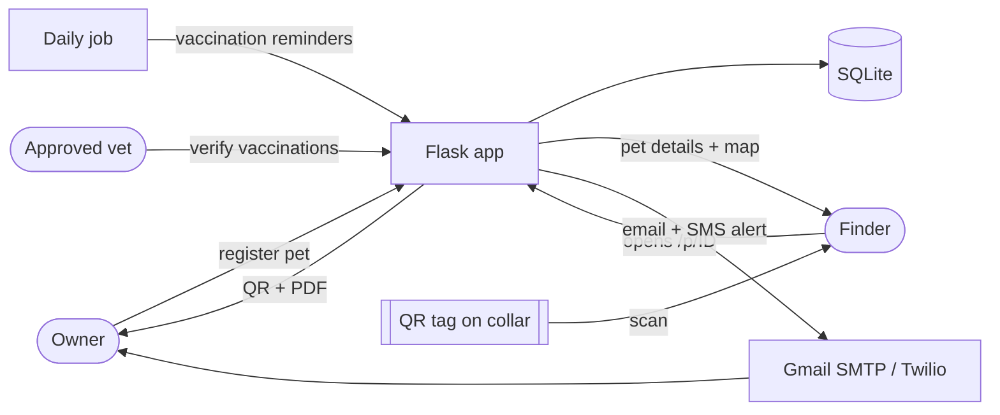

# 🐾 PetID — an ID card for pets

Owners (and caretakers of street animals) register an animal, print a **QR tag** for the collar,
and anyone who finds the animal can scan it to see its details and contact the owner.
**Every scan sends the owner an email + SMS.**

## Features
| Area | What it does |
|---|---|
| Accounts | Sign up / log in, password reset by email, multiple pets per account, profile page |
| Pet records | Photo, breed, age, microchip, sterilization, vet, food & medical notes, backup contact |
| Vaccinations | Choose how many, enter each one; due-date badges (OK / due soon / overdue) |
| QR tag | Printable PDF (large + small tag); **regenerate** the QR if a tag is lost |
| Scan alerts | Email + SMS (+ optional WhatsApp) to owner and backup contact on every scan |
| Finder tools | Message form with optional **exact GPS location**; owner is alerted instantly |
| Lost pets | Lost mode banner, printable **lost-pet poster** PDF |
| Reminders | Email + SMS a week before a vaccination is due, and once if overdue |
| Health card | Downloadable vaccination record PDF for vets and boarding |
| Vet verification | Approved vets can mark a vaccination as verified (shown with a ✔ on the public page) |
| Community mode | Register street animals; public list grouped by neighbourhood |
| Privacy controls | Owner chooses what finders see (phone, notes, vaccinations, map, microchip) |
| Transfer | Hand a pet to a new owner by email; the printed tag keeps working |
| Admin | Stats, lost pets, vaccinations due, vet approvals |
| Languages | English / हिन्दी on the finder-facing pages |
| Installable | Works as an installable web app (PWA) on phones |

## How it works


## Project layout
```
app.py        routes (pages and actions)         security.py  login, CSRF, CAPTCHA, rate limits
db.py         tables                              notify.py    email / SMS / WhatsApp
helpers.py    dates, vaccinations, photos         pdfs.py      tag, poster, health card
i18n.py       English + Hindi text                tasks.py     vaccination reminders
templates/    HTML pages                          static/      CSS, icons, PWA files
tests/        automated tests                     docs/        privacy & security notes
```

## Run it
```
python -m venv venv
venv\Scripts\activate            # Windows   (Mac/Linux: source venv/bin/activate)
pip install -r requirements.txt
copy .env.example .env           # then edit .env
python app.py                    # http://127.0.0.1:5000
```
To scan a QR with your phone, set `BASE_URL` in `.env` to `http://<your-laptop-IP>:5000`
(same Wi-Fi) and register a new pet. Without email/SMS settings, alerts are printed in the terminal.

The first account created with the email in `ADMIN_EMAIL` becomes the admin.

## Tests
```
python -m unittest -v
```
27 tests cover accounts, ownership checks, CSRF on every form, scan alerts and cooldown,
GPS reports, reminders (sent once), vet verification, transfers, privacy flags, PDFs,
language switching and the database upgrade path.

## Deploy
1. Push the project to GitHub (`.env` and the database are ignored by `.gitignore`).
2. Create a web service on Render / Railway using the `Procfile` (or `render.yaml`).
3. Set the environment variables from `.env.example` — especially `SECRET_KEY`, `BASE_URL`
   (your https address), `TRUST_PROXY=1`, `CRON_TOKEN`.
4. **Storage:** SQLite and uploaded photos live in `PETID_DATA_DIR`. Point it at a persistent
   disk/volume, otherwise they are wiped on redeploy (fine for a demo only).
5. **Reminders:** call `https://YOUR-SITE/tasks/reminders?token=<CRON_TOKEN>` once a day from a
   free cron service such as cron-job.org.
6. Finder GPS only works on **HTTPS** (browsers block location on plain http).

## Known limitations / next steps
- Email addresses are not verified at sign-up (a typo means alerts go nowhere).
- Rate limits are in memory — fine for one server process, not for several.
- SQLite is great for a demo; move to PostgreSQL for real traffic.
- The home-area map is based on the locality text, so accuracy depends on how well Google
  recognises it. The community page lists areas rather than showing one combined map.
- SMS to Indian numbers is subject to telecom registration rules; check your provider.

## Screenshots
Add images to `docs/screenshots/` (see the README there) and link them here.
